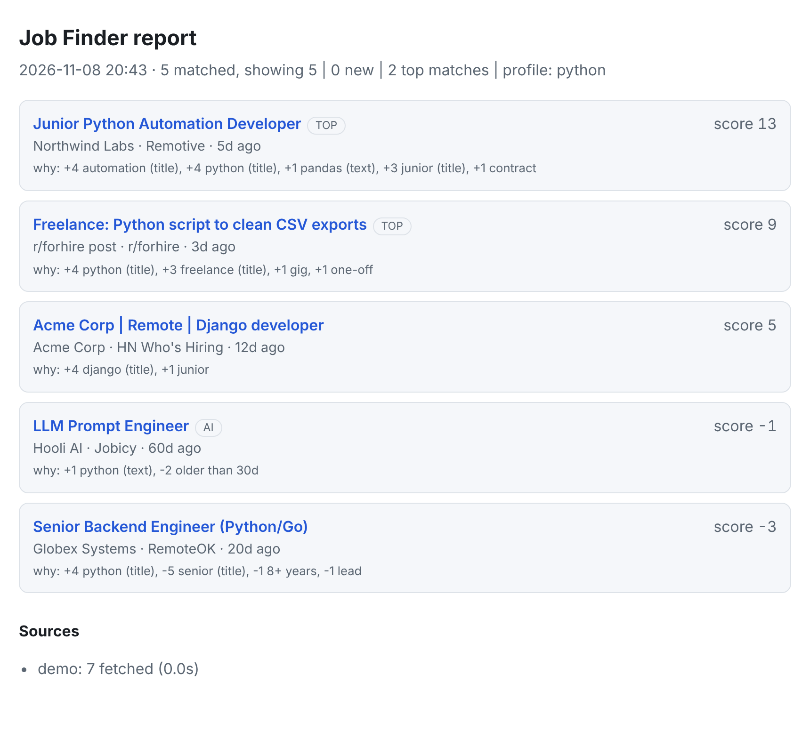

# Job Finder

[](https://github.com/Sam-did-this/job-search-tools/actions/workflows/ci.yml)


**One command, every source: remote tech jobs, freelance gigs and local work, scored, de-duplicated and tracked between runs.**



Job boards bury you in noise. Job Finder pulls from public APIs and feeds in parallel, ranks each listing against a profile (e.g. *junior Python / freelance*), hides what you've already seen, and writes a clean report you can read in the terminal, open in a browser, or drop into a spreadsheet.

## Features

- **11 sources** behind one plug-in registry: Remotive, RemoteOK, We Work Remotely, python.org, Arbeitnow, Jobicy, Hacker News (*Who is hiring?* and *Freelancer? Seeking freelancer?*), Reddit, plus opt-in Adzuna and Craigslist for local work.
- **Scoring profiles**: `dev`, `python`, `security`, `ai`, `latam`, `gigs`, or define your own in TOML. Junior/freelance terms rank up; senior/staff/10+ years rank down. `--explain` shows exactly why each job scored as it did.
- **Whole-word keyword matching**: `ai` no longer matches "email", and `rn` no longer matches "learn".
- **Smart history (SQLite)**: new vs. seen, cross-post detection (same company + title on two boards), and `applied` / `saved` / `ignored` tracking.
- **Five output formats**: terminal text, Markdown, CSV, JSON and a self-contained HTML page with dark-mode support.
- **Resilient**: retries with backoff, per-source error reporting (a blocked site says `HTTP 403`, it doesn't silently return "no jobs"), and one failing source never stops the rest.
- **Safe by default**: feeds are parsed with `defusedxml`; reports escape untrusted text, only link `http(s)` URLs, and neutralise spreadsheet formula injection in CSV.
- **Notifications**: optional push of new matches to your phone via [ntfy.sh](https://ntfy.sh).
- **Cross-platform**: Linux, macOS and Windows (UTF-8 safe). CI runs on Linux and Windows.

## Install

Requires Python 3.11+.

```bash
git clone https://github.com/Sam-did-this/job-search-tools.git
cd job-search-tools

python -m venv .venv
source .venv/bin/activate          # Windows: .venv\Scripts\activate
pip install -e .
```

Or install it as a standalone command with [pipx](https://pipx.pypa.io): `pipx install .`

## Quick start

```bash
job-finder --demo                           # offline sample data, no network needed
job-finder                                  # search every default source
job-finder -s python --since 3d             # Python jobs from the last 3 days
job-finder -p security --explain            # cybersecurity profile, show scoring reasons
job-finder -p python --new-only -o jobs.md  # only new jobs, saved to ~/Documents/jobs.md
job-finder -s "python, django" -o report.html
```

The v1 flags (`-s`, `-o`) work exactly as before.

### Sample output

```text
========================================================================
JOB FINDER  2026-11-08 20:43
5 matched, showing 5 | 0 new | 2 top matches | profile: python
========================================================================

 1. Junior Python Automation Developer  TOP
    Northwind Labs - Remotive · 5d ago  [score 13]
    https://example.com/demo/1
    id: 9db7fb17

 2. Freelance: Python script to clean CSV exports  TOP
    r/forhire post - r/forhire · 3d ago  [score 9]
    https://example.com/demo/4
    id: bb9f1bba

 3. Acme Corp | Remote | Django developer
    Acme Corp - HN Who's Hiring · 12d ago  [score 5]
    https://example.com/demo/6
    id: 53cea3be

 4. LLM Prompt Engineer  AI
    Hooli AI - Jobicy · 60d ago  [score -1]
```

## Command reference

| Command | What it does |
|---|---|
| `job-finder [search]` | Search (default command) |
| `job-finder sources` | List sources and which are on by default |
| `job-finder mark <id> applied\|saved\|ignored\|seen` | Track a job (ids are printed under each result) |
| `job-finder history [--status applied] [-n 20]` | Show what you've seen or applied to |
| `job-finder init-config` | Write an example `config.toml` to the right place for your OS |

Search options:

| Flag | Meaning |
|---|---|
| `-s, --search "python, ai"` | Job must mention at least one of these words (title, company, tags or description) |
| `-x, --exclude "unpaid"` | Hide jobs whose title, company or tags mention these |
| `-p, --profile NAME` | Scoring profile (`dev`, `python`, `security`, `ai`, `latam`, `gigs`, or your own) |
| `--sources a,b` / `--sources all` | Choose sources (see `job-finder sources`) |
| `--since 12h\|3d\|2w` | Only recent listings (listings with no date are kept) |
| `--min-score N` | Hide low-scoring jobs |
| `-n, --limit N` | Maximum jobs shown |
| `--new-only` | Only jobs not seen in earlier runs |
| `--show-ignored` | Include jobs you marked `ignored` |
| `--explain` | Show the scoring breakdown per job |
| `-f, --format text\|md\|csv\|json\|html` | Output format (inferred from the `-o` extension if omitted) |
| `-o, --output FILE` | Save to a file; a bare name goes to `output_dir` (default `~/Documents`) |
| `--ntfy TOPIC` | Push new matches to an ntfy.sh topic |
| `--no-history` | Don't read or update history |
| `--no-emoji` | Plain-ASCII badges for terminals that can't render emoji |
| `--demo` | Offline sample data |
| `--config PATH`, `-v` | Alternate config file, debug logging |

Exit codes: `0` success, `1` no source returned data, `2` bad arguments or config.

## Sources

| Source | Kind | Access | Notes |
|---|---|---|---|
| `remotive` | remote | public API | Software-dev category. Please don't poll more than a few times a day. |
| `remoteok` | remote | public API | Their terms ask for a link back to RemoteOK when you republish listings. |
| `wwr` | remote | RSS | We Work Remotely programming feed. |
| `python-org` | remote | RSS | Python-specific jobs. |
| `arbeitnow` | remote | public API | Only listings flagged remote. |
| `jobicy` | remote | public API | Tag set with `jobicy_tag` in config. |
| `hn-hiring` | remote | Algolia API | Latest monthly *Ask HN: Who is hiring?* thread. |
| `hn-freelance` | freelance | Algolia API | Latest *Freelancer? Seeking freelancer?* thread, good for small gigs. |
| `reddit` | freelance | RSS | Subreddits set in config. On r/forhire only `[HIRING]` posts are kept. |
| `adzuna` | local | API (free key) | Opt-in. Set `ADZUNA_APP_ID` and `ADZUNA_APP_KEY`. |
| `craigslist` | local | HTML scrape | Opt-in, best-effort. Craigslist restricts automated access, so check their terms and use it sparingly. |

LinkedIn, Indeed and Upwork are deliberately **not** included: they forbid scraping and actively block it.

If a site changes its format, that source reports an error and the others carry on.

## Profiles and scoring

Every job gets an integer score so the best matches float to the top:

| Signal | Points |
|---|---|
| Profile/`-s` keyword in the **title** | +4 each |
| ...in tags | +2 each |
| ...in the description | +1 each |
| Boost word (junior, entry level, freelance, contract...) in the title / elsewhere | +3 / +1 |
| Penalty word (senior, staff, principal, 10+ years...) in the title / elsewhere | -5 / -1 |
| Posted < 24h / < 3 days | +2 / +1 |
| Older than 30 days | -2 |
| Salary listed | +1 |

Jobs scoring 8 or more get a TOP badge. Run with `--explain` to see the arithmetic.

Define your own profile in `config.toml`:

```toml
[profiles.freelance-python]
include  = ["python", "django", "fastapi", "automation", "scraping"]
boost    = ["freelance", "contract", "part-time", "junior"]
penalize = ["senior", "staff", "10+ years"]
exclude  = ["unpaid"]
```

```bash
job-finder -p freelance-python --since 7d -o gigs.html
```

## Configuration

Run `job-finder init-config` to create the file; it prints where it put it (on Linux that's `~/.config/job-finder/config.toml`). Everything is optional; see [`config.example.toml`](config.example.toml) for all keys.

History lives in a SQLite file in your OS's user-data folder (override with `history_db`). It never touches the repo.

## Tracking applications

```bash
job-finder -p python --new-only          # see what's new today
job-finder mark 9db7fb17 applied         # remember you applied
job-finder mark bb9f1bba ignored         # hide it from future runs
job-finder history --status applied      # review everything you applied to
```

If you used v1, your old `~/job_finder_pro_history.json` is imported automatically the first time the new history database is created.

## Run it every day

**Linux/macOS (cron)**: new matches to your phone each morning:

```cron
0 8 * * *  job-finder -p python --since 1d --new-only --ntfy my-unguessable-topic -o ~/Documents/jobs.md
```

ntfy topics are public by name, so choose a long random one.

**systemd user timer** (`~/.config/systemd/user/job-finder.service` + `.timer`):

```ini
# job-finder.service
[Service]
Type=oneshot
ExecStart=%h/job-search-tools/.venv/bin/job-finder -p python --since 1d --new-only -o jobs.md

# job-finder.timer
[Timer]
OnCalendar=*-*-* 08:00
Persistent=true
[Install]
WantedBy=timers.target
```

Then `systemctl --user enable --now job-finder.timer`.

**Windows**: Task Scheduler, action `C:\path\to\.venv\Scripts\job-finder.exe` with arguments `-p python --since 1d --new-only -o jobs.md`.

## Project layout

```text
src/job_finder/
  cli.py        argument parsing and commands
  core.py       runs sources in parallel, isolates failures
  filters.py    whole-word matching, profiles, scoring, de-duplication
  history.py    SQLite history and application tracking
  report.py     text / markdown / csv / json / html renderers
  config.py     defaults + TOML config
  http.py       one shared requests session: retries, timeout, User-Agent
  notify.py     ntfy.sh push notifications
  sources/      one function per source, registered with @register
tests/          pytest suite, runs against saved fixtures (no network)
```

## Adding a source

A source is one function that returns `Job` objects. Register it and it appears in `--sources`, the docs listing and the CLI automatically:

```python
# src/job_finder/sources/boards.py
@register("mysite", description="My Site public API")
def fetch_mysite(client, cfg):
    data = client.get_json("https://example.com/api/jobs")
    return [
        Job(title=j["title"], url=j["url"], company=j["company"], source="MySite")
        for j in data["jobs"]
    ]
```

Then drop a trimmed API response into `tests/fixtures/` and add a test next to the others.

## Development

```bash
pip install -e ".[dev]"
pytest          # 60+ tests, no network needed
ruff check . && ruff format --check .
```

CI (GitHub Actions) runs lint and tests on Python 3.11-3.13 on Linux and Windows.

## Responsible use

This tool is for personal job searching. It identifies itself honestly with its own User-Agent, retries politely, and favours official APIs and feeds. Respect each site's terms, keep the request volume low, and don't republish listings in bulk.

## Roadmap

- Freelancer.com project source (needs OAuth)
- LATAM boards: Workana, Torre, Get on Board
- Optional on-disk response cache
- Telegram / email notifications

## License

[MIT](LICENSE)
